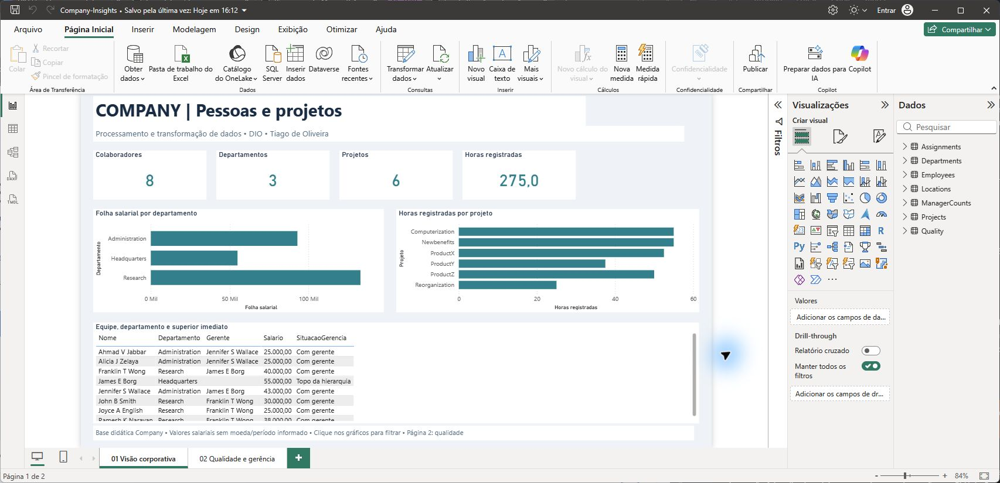
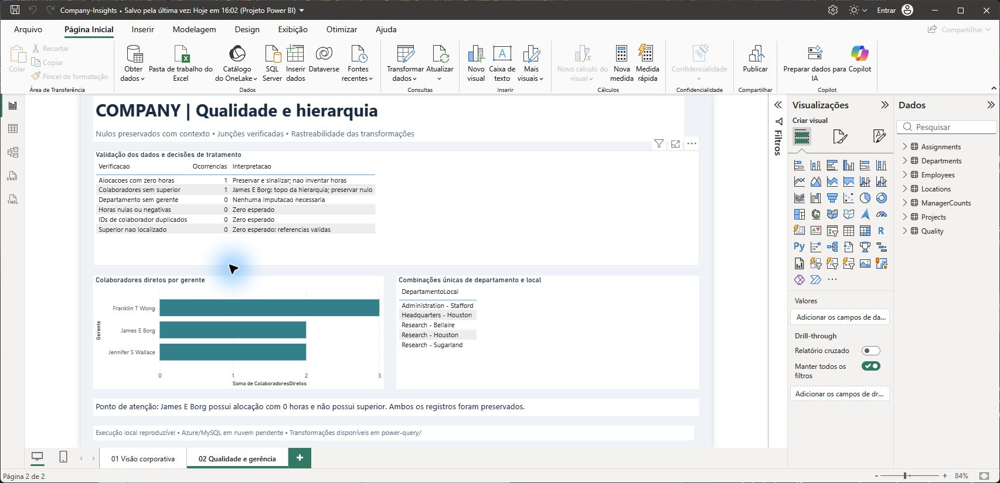

# Company Insights — ETL com Power BI

Projeto do desafio **Processando e Transformando Dados com Power BI**, da DIO. Autor: **Tiago de Oliveira**.

A base didática Company foi tratada no Power Query para analisar colaboradores, departamentos, superiores imediatos e horas por projeto. As decisões de qualidade são visíveis no próprio relatório e documentadas neste repositório. Os registros são do exemplo acadêmico público fornecido pela professora; [origem e rastreabilidade dos dados](dados/ORIGEM.md).

## Abrir o projeto

Abra **Company-Insights.pbix** no Power BI Desktop. O arquivo inclui os dados da versão local e não depende de caminhos de arquivo do computador do autor.

Para estudar ou modificar o código, abra **Company-Insights.pbip** mantendo as pastas `Company.Report` e `Company.SemanticModel` juntas. Ao abrir o projeto de código em outro computador, clique em **Atualizar** para carregar as fontes didáticas incorporadas.

## Resultado

| Indicador | Valor da base completa |
|---|---:|
| Colaboradores | 8 |
| Departamentos | 3 |
| Projetos | 6 |
| Alocações pessoa/projeto | 16 |
| Horas registradas | 275 |
| Soma dos salários da fonte | 281.000 |
| Combinações departamento/local | 5 |

Os valores salariais não receberam moeda ou periodicidade, pois essas informações não constam na fonte. A base não informa uma data de competência para as horas; não foram criadas tendências temporais artificiais.

### 01 — Visão corporativa

Indicadores, folha salarial por departamento, horas por projeto e equipe com superior imediato. A seleção de uma barra filtra ou realça os dados relacionados.

### 02 — Qualidade e gerência

Regras de qualidade, colaboradores diretos por gerente e combinações únicas de departamento/local. James E Borg foi preservado como topo da hierarquia; sua alocação com zero horas foi sinalizada para revisão.

## Transformações exigidas pelo desafio

- Tipos e cabeçalhos revisados; valores monetários em double.
- Nulos analisados, sem exclusão indiscriminada ou preenchimento inventado.
- Verificação dos três gerentes de departamento e das horas dos projetos.
- Endereço separado em número, rua, cidade e estado, preservando ruas com hífen.
- LEFT OUTER JOIN de employee com departament, mantendo employee como base.
- Autojunção para obter o nome do superior imediato.
- Nome completo composto por nome, inicial e sobrenome.
- Mescla de departamento/local e criação de combinação única.
- Agrupamento dos sete vínculos de subordinação direta em três gerentes.
- Remoção de colunas redundantes das tabelas finais e definição da granularidade.

**Mesclar × acrescentar:** mesclar associa colunas por uma chave; acrescentar apenas empilha linhas. Para associar o departamento à sua localização, precisamos mesclar por Dnumber e depois concatenar nome e local. Acrescentar não cria essa associação.

Consulte [as decisões de transformação](docs/TRANSFORMACOES.md), [as consultas Power Query](power-query/) e [o SQL de transformação e auditoria](sql/02-transformacoes-e-auditoria.sql).

## Execução e limites

**Versão local executada e validada no Power BI Desktop.** As seis fontes didáticas estão incorporadas nas consultas `raw_*`, sem carga no modelo; sete tabelas tratadas são carregadas. Os CSVs permitem consultar os dados originais sem abrir o relatório.

**Integração Azure/MySQL: pendente.** Esta versão não afirma ter provisionado um servidor Azure nem realizado uma atualização a partir da nuvem. O cadastro/assinatura Azure é uma etapa separada. O [guia Azure](docs/AZURE.md) descreve como conectar as mesmas transformações ao MySQL quando o servidor estiver disponível.

O script de criação e carga foi executado em uma instância temporária isolada de **MariaDB 10.4.32**, compatível com os comandos utilizados, e reconciliou 8 colaboradores, 281.000 em salários e 275 horas. Isso valida a execução local do SQL, não equivale a testar o serviço MySQL gerenciado da Azure. O banco temporário foi encerrado após a validação.

## Arquivos

| Caminho | Conteúdo |
|---|---|
| `Company-Insights.pbix` | Relatório pronto com dados incorporados |
| `Company-Insights.pbip` | Entrada do projeto editável |
| `Company.Report/` | Definições das duas páginas e visuais |
| `Company.SemanticModel/` | Modelo, consultas M, medidas e relacionamentos |
| `power-query/` | Consultas legíveis, incluindo fontes e transformações |
| `sql/01-company.sql` | Criação/carga corrigida, sem apagar bancos existentes |
| `sql/02-transformacoes-e-auditoria.sql` | Junções, agrupamentos e auditorias |
| `dados/` | Seis tabelas de origem em CSV |
| `docs/` | Prévias, decisões e evidências de validação |

As pastas `.pbi` são caches locais e não devem ser versionadas. Não há credenciais no projeto.

## Créditos e materiais do desafio

Dados e referência didática: **Juliana Mascarenhas / Juliana Zanelatto e DIO**. O relatório, as consultas organizadas, as correções do script e a documentação deste projeto foram preparados a partir desse material, com autoria e origem identificadas.

- [Repositório original — Power BI Analyst](https://github.com/julianazanelatto/power_bi_analyst)
- [Base Company — Módulo 3](https://github.com/julianazanelatto/power_bi_analyst/tree/main/M%C3%B3dulo%203/Desafio%20de%20Projeto)
- [Instruções oficiais do desafio](https://hermes.dio.me/files/assets/a8bf65e2-a503-46c9-9453-bd6bdf329e83.docx)
- [Slides oficiais](https://hermes.dio.me/files/assets/e7d723b3-fe92-42fa-b12c-cd33b56d81c8.pptx)
- [Formato de projetos Power BI](https://learn.microsoft.com/power-bi/developer/projects/projects-overview)

