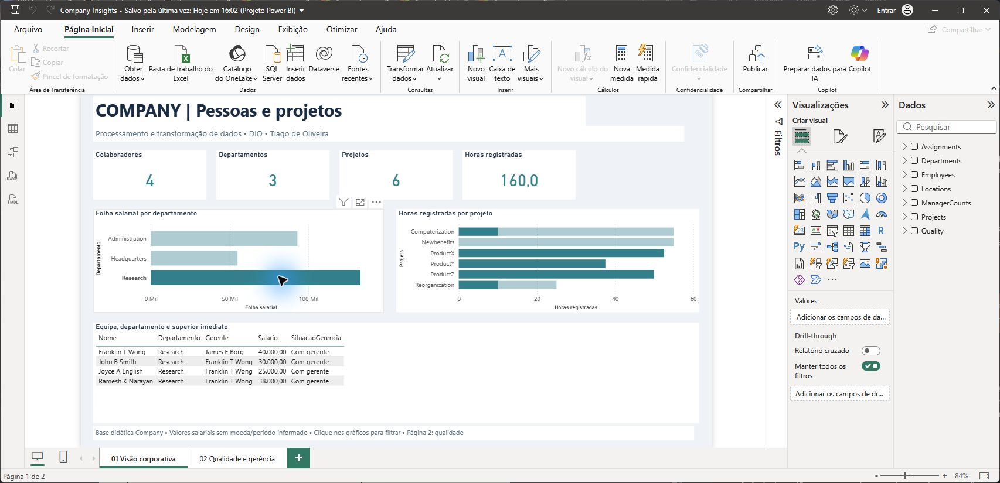

# Validação da versão local

Verificado em 12/11/2026.

## Banco de dados

O arquivo `sql/01-company.sql` foi executado sem erros em banco temporário isolado com MariaDB 10.4.32. Nenhum banco previamente existente foi modificado. Resultado das consultas:

| Verificação | Resultado |
|---|---:|
| COUNT(employee) | 8 |
| SUM(employee.Salary) | 281000 |
| COUNT(works_on) | 16 |
| SUM(works_on.Hours) | 275 |

## Power BI Desktop

- As consultas foram atualizadas no aplicativo e as duas páginas foram abertas.
- Cartões da visão completa: 8 colaboradores, 3 departamentos, 6 projetos e 275 horas.
- Research: 4 colaboradores, soma salarial 128000 e 160 horas de seus colaboradores.
- O clique na barra Research alterou os cartões para 4 colaboradores e 160 horas e filtrou a tabela de equipe. Departamentos e Projetos são cartões das dimensões e permanecem totais por causa da direção dos relacionamentos.
- Quality: 1 colaborador sem superior, 0 superiores inválidos, 0 departamentos sem gerente, 1 alocação com zero horas, 0 horas nulas/negativas e 0 IDs duplicados.
- Gerentes com subordinados diretos: Franklin 3, James 2 e Jennifer 2.
- Locations: 5 combinações únicas; Research possui 3 locais sem duplicar a tabela Employees.

## Limites da validação

Não houve teste de conexão com Azure nesta versão local. A execução SQL em MariaDB não é apresentada como evidência de provisionamento ou de conexão com MySQL na nuvem.

